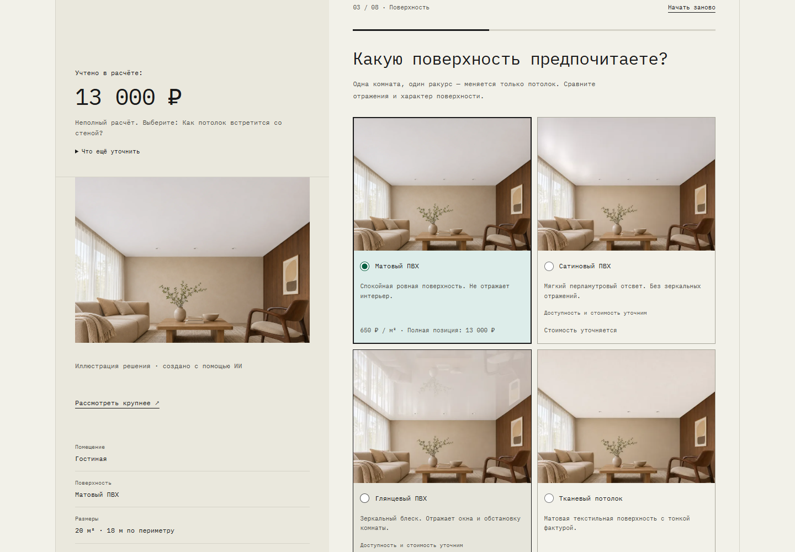
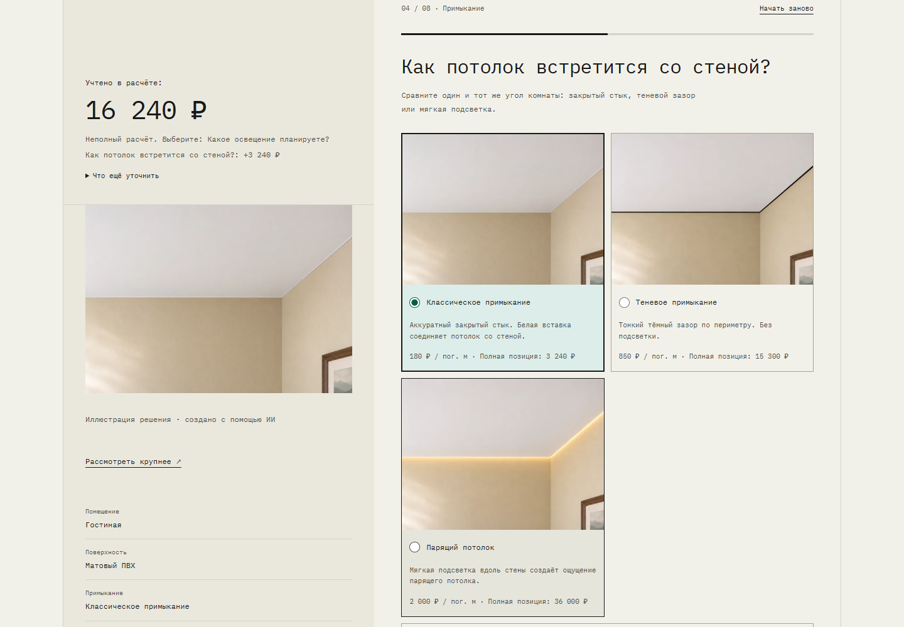
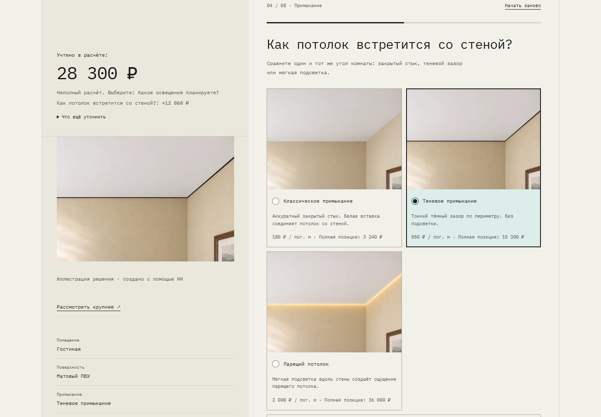
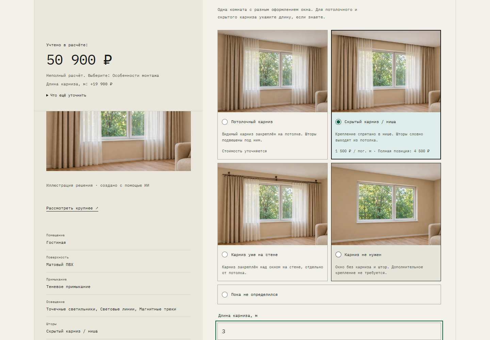
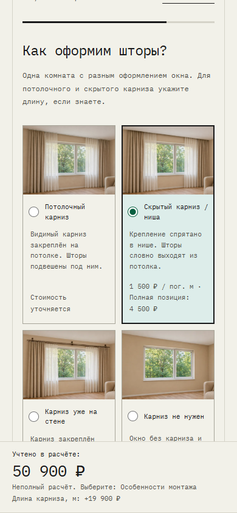

# Видимая стоимость во время выбора

Калькулятор: http://127.0.0.1:8000/calculator/ и секция `/#calculator`. Production не развёртывался.

На компьютере блок стоимости находится сверху левой колонки и закрепляется при прокрутке длинного шага. На телефоне это одна нижняя панель: высота измеряется для отступа под содержимым, учитывается safe area, при фокусе текстового поля панель скрывается. Кнопки навигации остаются в потоке страницы. Итоговый экран показывает подробную разбивку до контактов.

До размеров и материала отображается просьба их указать, без нулевой цены. После выбора показаны «Учтено в расчёте», сумма, признак неполной сметы и недостающий ответ. Когда все ответы есть, подпись сообщает о предварительной стоимости. Последнее изменение объясняется разницей общей суммы; смена версии тарифов имеет отдельное сообщение. В карточках цены за единицу и полные стоимости позиции подписаны явно. Без утверждённой ставки показывается «Стоимость уточняется».

`POST /api/calculate/` с `schema=v2&preview=1` принимает частичный черновик. Числа и допустимые значения по-прежнему валидируются; незаполненные выборы не создают платных позиций. Сервер возвращает quote и цены альтернатив из активной PricingVersion. `priced_item` используется и финальной сметой, и ценами вариантов; JavaScript не содержит тарифов и формул стоимости. Флаг preview не используется при отправке заявки: её проверка, версия, снимок, вложения и идемпотентность сохранены.

Ввод пересчитывается с задержкой 350 мс. Предыдущий запрос отменяется, ревизия защищает от позднего ответа. Пока запрос идёт, старая сумма скрывается. Ошибка сети и некорректный ввод имеют пояснение и кнопку повтора. Возврат и восстановление черновика пересчитывают текущие ответы. Неизвестная база и сатин/глянец не получают вымышленной суммы; люстры, отдельный LED, дополнительные работы и выезд сохраняют предупреждения об уточнении.

## Проверки

Итог: все 87 серверных тестов прошли; JavaScript model/syntax, Django check и `git diff --check` успешны. Impeccable detector сообщил только рекомендации по существующим дополнительным цветам.

- Серверные тесты на изолированных исходных ставках: 13 000 → 16 240 → 28 300 → 31 000 → 50 900 ₽; смена/удаление позиций; изменение размеров/материала; неполные и некорректные ответы; строгость окончательной проверки; совпадение preview/final; новая версия ставок. Рабочие тарифы не перезаписывались.
- Playwright, `scripts/test-calculator-live-price.js`: та же последовательность, разница +12 060 ₽ при смене примыкания, карточки ставок, финальный результат, удаление света/карниза, глянец, возврат, восстановление после reload, потеря сети и повтор, скрытие старой суммы, поздний ответ, уведомление об обновлении версии, ширины 320/390/768/1024/1440, скрытие панели при фокусе числового поля.
- Повторены сценарии аудита формы и ошибок: серверный POST, отключённый JavaScript, десятичная запятая, сохранение контакта при ошибке и повтор, защита от дублей интерфейса. Внешние Telegram-сообщения не отправлялись.

Проверки телефона выполнены в Chromium с эмуляцией размеров и фокуса, без физического устройства и реальной экранной клавиатуры. Коммерческое подтверждение ставок остаётся за владельцем.

## Последовательные скриншоты

